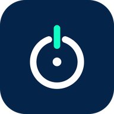
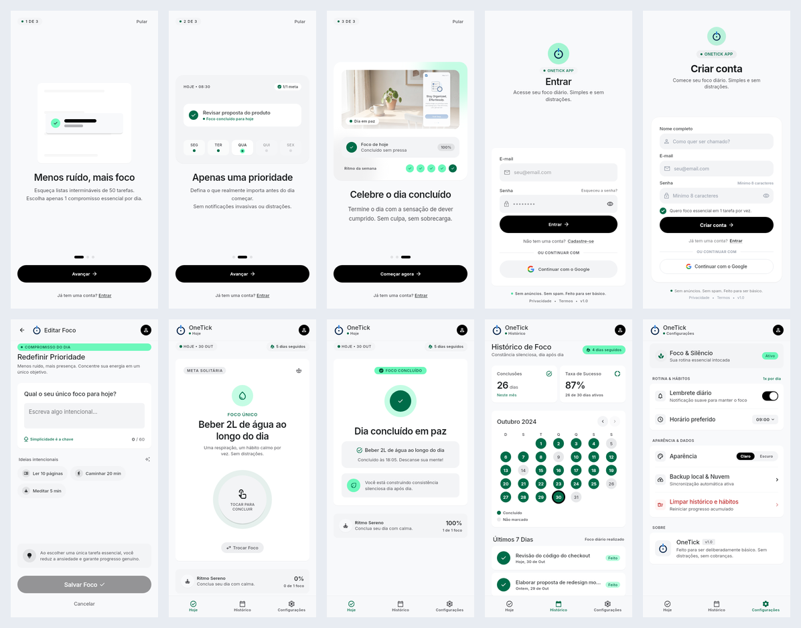

<div align="center">



# OneTick

**Um foco essencial por dia: escolha uma única tarefa, conclua com calma e acompanhe sua constância.**


[](https://www.figma.com/design/VkOOGKJqZLH9TUwbwAQUUE/onetick)




</div>

## Sobre

Aplicativo de foco diário. Em vez de listas intermináveis, o usuário define **uma única meta por dia**, toca para concluir e acompanha o histórico: sequência de dias, taxa de sucesso e calendário do mês. Sem anúncios, sem cobranças, feito para ser deliberadamente básico. Foco em **Android e iOS**; uma versão web fica para o futuro.

## Links

| | |
|---|---|
| Android | Google Play — em breve (por enquanto, rodar via `flutter run`) |
| iOS | App Store — em breve (por enquanto, rodar via `flutter run`) |
| Design no Google Stitch | [OneTick — Stitch](https://stitch.withgoogle.com/projects/3290547221674662054) |
| Design no Figma (levado do Stitch) | [onetick](https://www.figma.com/design/VkOOGKJqZLH9TUwbwAQUUE/onetick) |
| Tarefas | [`docs/tasks/BOARD.md`](docs/tasks/BOARD.md) |
| Revisão do design | [`docs/design-review.md`](docs/design-review.md) |
| Configurar o Firebase | [`docs/setup/firebase.md`](docs/setup/firebase.md) |

## O que tem no app

- **Onboarding** em 3 passos (pular, avançar, ir para login)
- **Cadastro e login** com e-mail/senha e Google, validação de campos e recuperação de senha por e-mail
- **Hoje**: foco do dia, toque para concluir, sequência de dias seguidos e tela de foco concluído
- **Definir foco**: texto de até 60 caracteres, contador, ideias rápidas e edição do foco do dia
- **Histórico**: conclusões e taxa de sucesso do mês, calendário com navegação entre meses e últimos 7 dias
- **Configurações**: lembrete diário (liga/desliga e horário), tema claro/escuro, limpar histórico e sair da conta
- Estados de **carregando, erro e vazio** em todas as telas, e layout que rola em telas pequenas, com teclado aberto e fonte grande
- Dados salvos por usuário no Firestore (`users/{uid}`), com regras de segurança

## Tecnologias

- [Flutter](https://flutter.dev) e [Dart](https://dart.dev)
- [flutter_bloc](https://pub.dev/packages/flutter_bloc) (Cubit) e [get_it](https://pub.dev/packages/get_it) para injeção de dependência
- [Firebase Auth](https://firebase.google.com/products/auth), [Cloud Firestore](https://firebase.google.com/products/firestore) e Google Sign-In
- [flutter_svg](https://pub.dev/packages/flutter_svg) para os ícones exportados do Figma
- Fonte [Inter](https://rsms.me/inter/) embutida (funciona offline)
- `flutter_test`, `bloc_test` e `mocktail`

## Como rodar

Pré-requisitos: Flutter 3.47+ e um emulador ou aparelho.

```bash
flutter pub get
flutter run -t lib/main/main.dart   # sobe o app
flutter analyze                     # análise estática
flutter test                        # unitários, widgets, fluxo completo e goldens
```

Sem o Firebase configurado, o app roda em **modo local** (dados em memória, com uma faixa vermelha no rodapé em debug). Para ligar o Firebase de verdade:

```bash
dart pub global activate flutterfire_cli
flutterfire configure --out=lib/main/firebase_options.dart
firebase deploy --only firestore:rules
```

Passo a passo completo em [`docs/setup/firebase.md`](docs/setup/firebase.md).

## Estrutura

```text
lib/
  main/                 entrypoint, app, gate de sessão e di/ (injeção por tela)
  core/                 tema, assets, widgets compartilhados e utilitários
  domain/<feature>/     entidades, contratos de repositório e casos de uso
  data/<feature>/       modelos e implementações dos repositórios
  infra/adapters/       Firebase (Auth e Firestore) e versões em memória
  presenter/<feature>/  cubits e states
  modules/<feature>/    page (decide o estado), view e widgets
assets/                 ícones SVG, imagens e fontes
docs/                   arquitetura, tarefas, setup do Firebase e revisão do design
test/                   domínio, dados, widgets, fluxo completo e goldens
tool/                   gerador do ícone do app
```

A arquitetura segue [`docs/architecture`](docs/architecture): **Clean Architecture + Cubit**, com fluxo `modules → presenter → domain` e `data`/`infra` implementando os contratos. A *page* decide carregando, erro, vazio e sucesso; a *view* só renderiza o sucesso. Isso permite trocar o Firebase por fakes nos testes sem mexer em nenhuma tela.

## Qualidade

- `flutter analyze` sem avisos
- 100 testes: regras de domínio (sequência, validações, histórico), repositórios, fluxo completo do usuário, telas pequenas e *goldens* de cada frame do Figma em 440x890
- Os goldens ficam em [`test/goldens`](test/goldens) e servem de regressão visual

## Ícone e marca

A logo (anel + tick) e o ícone do app para Android, iOS e web são gerados por [`tool/generate_brand_assets.py`](tool/generate_brand_assets.py).

## Time

| | |
|---|---|
| [@dutrathiagodev](https://github.com/dutrathiagodev) | Projeto, arquitetura, telas em Flutter, Firebase, testes e documentação |
| [@rarydex](https://github.com/rarydex) | Design das telas no Google Stitch, levado para o Figma |

O trabalho segue o design criado no Stitch e levado ao Figma e está dividido em demandas `OT-xxxx`, listadas em [`docs/tasks/BOARD.md`](docs/tasks/BOARD.md).
